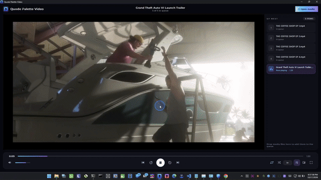

# Quode Palette Video

A fast, simple video and audio player for Windows. No clutter, no accounts, no ads. You open a file and it plays.

  

  

  

## Why you might like it

Most players either feel heavy or look like they were designed twenty years ago. Quode Palette Video is built to start quickly, stay out of your way and look good while doing it. It opens in about three seconds, uses very little memory and keeps everything you actually need within reach.

## Features

**Plays what you throw at it**
- Common video and audio formats, including MP4, MKV, MOV, AVI, WebM, MP3, FLAC and more
- Album art shows up when you play music, and if a track has no cover you see the app logo instead of a black screen

**A queue that behaves**
- Drag files onto the window to add them
- Reorder the queue by dragging
- Previous, next, repeat (off, all or one) and shuffle
- Open a file while the player is already running and it joins the same window

**It remembers things for you**
- Your queue, volume, speed and window size
- Where you stopped in each file, with an offer to resume next time

**Watch your way**
- Fullscreen with controls that appear when you move the mouse and hide when you stop
- A small always-on-top mini player you can drag, resize and bring back with a double-click
- Hold the left mouse button on the video to play at 2x speed, let go to return to normal
- Choose audio tracks and embedded subtitles from the right-click menu
- Playback speed control
- Your screen stays awake only while something is playing

**Looks sharp**
- Clean dark theme with a cyan and violet accent
- Icons are drawn in code, so they stay crisp on any display scale

## Download

Grab the latest version from the [Releases](../../releases) page. There are three options:

| File | Best for |
| --- | --- |
| `QuodePaletteVideo-Setup-1.0.0.0.exe` | Normal installation with a Start menu entry and an uninstaller |
| `QuodePaletteVideo-1.0.0.0-portable.exe` | One file you can run from anywhere, no install |
| `QuodePaletteVideo-1.0.0.0-win64-portable.zip` | Portable, unpacked into a folder you choose |

The portable exe unpacks itself the first time you run it, which takes a few seconds. After that it starts right away. Portable versions keep their settings in a `data` folder next to the app instead of the registry, so you can carry them on a USB stick.

### Requirements

- 64-bit Windows 10 or 11
- The installer adds the Microsoft Visual C++ runtime if your PC does not have it. If a portable version does not start, install the [Visual C++ Redistributable](https://aka.ms/vs/17/release/vc_redist.x64.exe) and try again.

## Keyboard shortcuts

| Key | Action |
| --- | --- |
| `Space` | Play or pause |
| `Left` / `Right` | Seek 5 seconds back or forward |
| `Ctrl` + `Left` / `Right` | Seek 60 seconds back or forward |
| `J` / `L` | Seek 10 seconds back or forward |
| `0` to `9` | Jump to 0% to 90% of the file |
| `Up` / `Down` | Volume up or down |
| `M` | Mute |
| `+` / `-` | Change playback speed |
| `N` / `P` | Next or previous item |
| `F` | Fullscreen |
| `Ctrl` + `M` | Mini player |
| `Esc` | Leave fullscreen or the mini player |
| `O` | Open files |

With the mouse, scroll over the video to change the volume, double-click it for fullscreen and right-click for the menu.

## Good to know

Playback uses Qt Multimedia with its FFmpeg backend, so format support and hardware decoding depend on your system and drivers. Subtitles work with tracks embedded in the file. External subtitle files are not supported yet.

## Feedback

Found a bug or have an idea? Open an issue on this repo, or reach us at [hello@quodepalette.com](mailto:hello@quodepalette.com).

## License

The app is free for personal, educational and other noncommercial use under the PolyForm Noncommercial License 1.0.0. For commercial use, please get in touch at [hello@quodepalette.com](mailto:hello@quodepalette.com).
